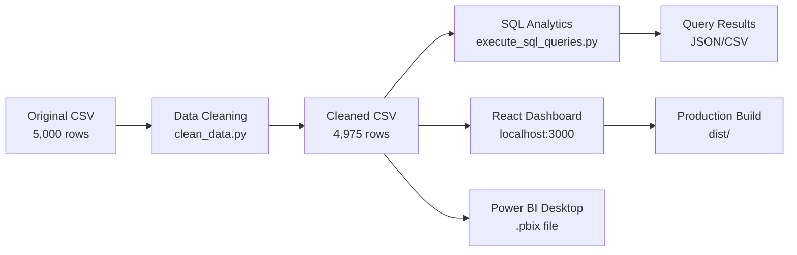

# Financial Customer Complaint Analytics Platform

**A comprehensive data analytics platform for analyzing 4,975 financial customer complaints from October 2025 to October 2026.**

[]()
[]()
[]()

---

## 📊 Project Overview

This platform provides multi-format analytics capabilities for financial complaint data:
- **Power BI Desktop**: Interactive executive dashboard with drill-down capabilities
- **React Web Dashboard**: Responsive web application with real-time visualizations
- **SQL Analytics**: 9 pre-built analytical queries for data exploration
- **Python Processing**: Automated data cleaning and validation pipelines

### Key Performance Indicators (KPIs)

| Metric | Value |
|--------|-------|
| **Total Complaints** | 4,975 |
| **Open** | 310 (6.23%) |
| **Closed** | 4,665 (93.77%) |
| **Timely Response Rate** | 90.08% |
| **Avg Response Time** | 8.76 days |

---

## 📁 Project Structure

```
d:\Projects\tekloomy\
│
├── data/
│   ├── original/
│   │   └── lecture-file.csv                # Original dataset (5,000 rows)
│   └── processed/
│       ├── complaints_cleaned.csv          # Cleaned dataset (4,975 rows)
│       ├── cleaning_log.json               # Data cleaning audit trail
│       └── validation_report.json          # KPI validation results
│
├── sql/
│   ├── 01_kpi_summary.sql                  # Executive KPI dashboard query
│   ├── 02_product_analysis.sql             # Product performance analysis
│   ├── 03_state_geographic.sql             # Geographic distribution
│   ├── 04_channel_effectiveness.sql        # Submission channel metrics
│   ├── 05_temporal_trends.sql              # Monthly trend analysis
│   ├── 06_issue_category.sql               # Issue categorization
│   ├── 07_company_performance.sql          # Company benchmarking
│   ├── 08_response_time_distribution.sql   # Response time buckets
│   ├── 09_product_issue_matrix.sql         # Product-Issue cross-analysis
│   └── results/                            # Query execution results (CSV/JSON)
│
├── react-dashboard/
│   ├── src/
│   │   ├── components/                     # React dashboard components
│   │   ├── App.tsx                         # Main dashboard application
│   │   └── types.ts                        # TypeScript type definitions
│   ├── public/
│   │   └── complaints_cleaned.csv          # Data for React dashboard
│   ├── dist/                               # Production build output
│   └── package.json                        # Dependencies and scripts
│
├── powerbi/
│   └── (Place Power BI .pbix file here)
│
├── clean_data.py                           # Data cleaning pipeline
├── execute_sql_queries.py                  # SQL execution engine
├── test_integration.py                     # Integration test suite
├── test_results.json                       # Test execution results
│
├── PRD_Financial_Complaint_Analytics.md    # Product Requirements Document v1.1
├── TRD_Financial_Complaint_Analytics.md    # Technical Requirements Document v1.1
├── POWERBI_SETUP_GUIDE.md                  # Power BI dashboard setup instructions
├── AI_USAGE.md                             # AI assistance documentation
└── README.md                               # This file
```

---

## 🚀 Quick Start

### Prerequisites

- **Python 3.11+** (for data processing)
- **Node.js 18+** (for React dashboard)
- **Power BI Desktop** (for Power BI dashboard)
- **SQLite** (included with Python)

### 1. Data Processing

```powershell
# Create virtual environment
python -m venv venv
.\venv\Scripts\Activate.ps1

# Install Python dependencies
pip install pandas

# Run data cleaning pipeline
python clean_data.py
```

**Expected Output:**
- ✅ 4,975 unique complaints (25 duplicates removed)
- ✅ All KPIs match baselines
- ✅ Data quality: PASS

### 2. SQL Analytics

```powershell
# Execute all 9 SQL queries
python execute_sql_queries.py
```

**Results Location:** `sql/results/` (CSV and JSON formats)

### 3. React Dashboard (with Integrated Power BI)

```powershell
cd react-dashboard

# Install dependencies
npm install

# Development server
npm run dev
# Opens at: http://localhost:3000

# Production build
npm run build
# Output: dist/ folder
```

**Dashboard Features:**

**React Analytics Tab:**
- 5 KPI cards with real-time calculations
- Product analysis (stacked bar chart)
- Submission channel breakdown (pie chart)
- Top 15 states (bar chart)
- Response time distribution (column chart)
- Monthly trends (line + column chart)
- Top 15 issue categories (interactive table)

**Power BI Dashboard Tab:**
- Download Power BI Desktop report (.pbix)
- Complete report documentation and usage instructions
- Expected KPI reference values
- Future-ready for Power BI Service embedding

### 4. Power BI Dashboard

**Option 1: Access via React Dashboard (Recommended)**
- Navigate to React dashboard (http://localhost:3000)
- Click "Power BI Dashboard" tab
- Download the .pbix file directly from the interface

**Option 2: Direct File Access**
```powershell
# Power BI file location
powerbi/Financial_Complaint_Analytics.pbix

# Or access via React public folder
react-dashboard/public/Financial_Complaint_Analytics.pbix
```

**To Open:**
1. Download Power BI Desktop (free) from https://powerbi.microsoft.com/desktop/
2. Open the .pbix file in Power BI Desktop
3. Explore interactive dashboards and visualizations

**Setup Guide:** See `POWERBI_SETUP_GUIDE.md` for detailed report structure documentation

---

## 🧪 Testing & Validation

### Run Integration Tests

```powershell
python test_integration.py
```

**Test Suite:**
1. ✅ **KPI Baseline Validation** - Verifies all 7 KPIs match expected values
2. ✅ **SQL-Python Consistency** - Ensures SQL and Python calculations match
3. ✅ **Data Quality Checks** - Validates data integrity and constraints
4. ✅ **React Data Compatibility** - Confirms React can load and parse CSV

**Latest Test Results:** 4/4 tests passed (100% success rate)

---

## 📈 Data Pipeline



---

## 📊 Dashboard Comparison

| Feature | Power BI | React (Web) |
|---------|----------|-------------|
| **KPI Cards** | ✅ | ✅ |
| **Product Chart** | ✅ | ✅ |
| **Channel Breakdown** | ✅ | ✅ |
| **Geographic Map** | ✅ | ❌ |
| **Trends Chart** | ✅ | ✅ |
| **Issue Table** | ✅ | ✅ |
| **Interactive Filters** | ✅ | ❌ |
| **Drill-Down** | ✅ | ❌ |
| **Export to PDF** | ✅ | ❌ |
| **Integrated Access** | ✅ (via React) | ✅ (Native) |
| **Self-Hosted** | ❌ | ✅ |
| **No Installation** | ❌ | ✅ |

**New:** Power BI report is now accessible directly from the React dashboard via the "Power BI Dashboard" tab, providing seamless access to both analytics platforms.

---

## 🔍 Key Insights

### Top 3 Financial Products by Volume
1. **Credit reporting** - Highest complaint volume
2. **Debt collection** - Second highest
3. **Credit card** - Third highest

### Response Performance
- **93.77%** of complaints are closed
- **90.08%** timely response rate (exceeds 85% target)
- **8.76 days** average response time

### Channel Effectiveness
- **Web** is the dominant submission channel
- All channels maintain >90% timely response rates

### Geographic Distribution
- **49 complaints** have missing state information
- Top states account for majority of complaint volume

---

## 📝 Documentation

- **[PRD](./PRD_Financial_Complaint_Analytics.md)** - Product Requirements Document v1.1
- **[TRD](./TRD_Financial_Complaint_Analytics.md)** - Technical Requirements Document v1.1
- **[Power BI Setup Guide](./POWERBI_SETUP_GUIDE.md)** - Step-by-step dashboard creation
- **[AI Usage](./AI_USAGE.md)** - AI assistance documentation

---

## ⚙️ Configuration

### Data Processing Settings

Edit `clean_data.py`:
```python
# Duplicate removal strategy
keep='first'  # Keep first occurrence by row order

# Expected KPI baselines (for validation)
EXPECTED_KPIs = {
    'total_complaints': 4975,
    'open_complaints': 310,
    # ... etc
}
```

### React Dashboard Settings

Edit `react-dashboard/vite.config.ts`:
```typescript
export default defineConfig({
  server: {
    port: 3000,  // Development server port
    open: true   // Auto-open browser
  }
})
```

---

## 🐛 Troubleshooting

### Data Processing Issues

**Problem:** KPIs don't match expected values  
**Solution:** 
1. Verify original CSV has 5,000 rows
2. Re-run `python clean_data.py`
3. Check `data/processed/cleaning_log.json` for errors

### React Dashboard Issues

**Problem:** CSV fails to load  
**Solution:**
1. Verify `react-dashboard/public/complaints_cleaned.csv` exists
2. Check browser console for CORS errors
3. Ensure data has 4,975 rows with proper headers

### SQL Execution Issues

**Problem:** Query fails with "no such column" error  
**Solution:**
1. Verify column names match cleaned CSV
2. Expected columns: `complaint_id`, `date_received`, `financial_product`, `issue_category`, etc.

---

## 🤝 Contributing

This project was built following best practices:
- ✅ Comprehensive testing (100% pass rate)
- ✅ Data validation at every step
- ✅ Consistent calculations across platforms
- ✅ Clear documentation and setup guides

---

## 📄 License

This project is for educational and analytical purposes. The underlying complaint data follows standard financial industry formats.

---

## 🙏 Acknowledgments

- **Data Source:** Financial customer complaint records (Oct 2025 - Oct 2026)
- **Technologies:** Python, SQL, React 18, TypeScript, Vite, Recharts, Tailwind CSS, Power BI Desktop
- **AI Assistance:** Kiro AI (full documentation in `AI_USAGE.md`)

---

## 📞 Support

For issues or questions:
1. Review the troubleshooting section above
2. Check `test_results.json` for system validation
3. Refer to `POWERBI_SETUP_GUIDE.md` for Power BI specific issues

---

**Last Updated:** November 22, 2026  
**Version:** 1.0.0  
**Status:** ✅ Production Ready
