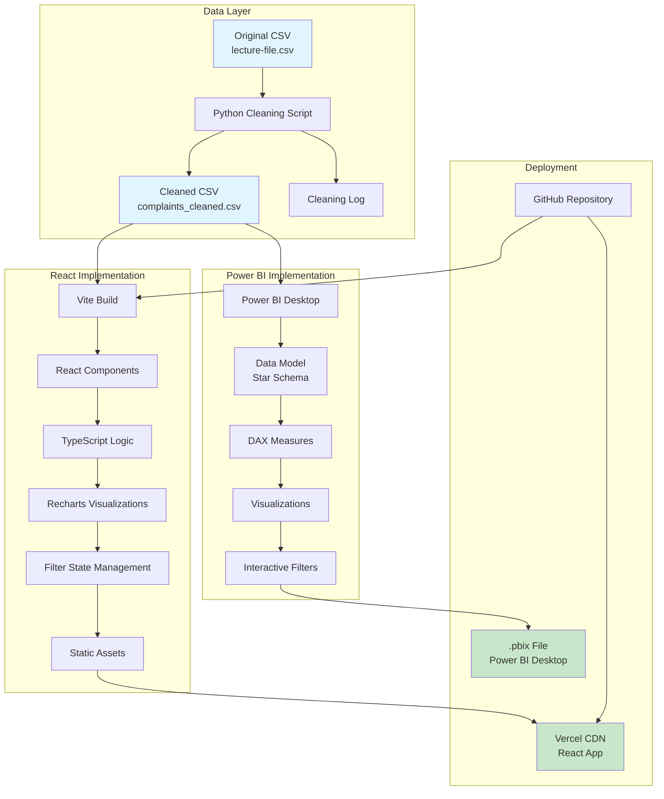
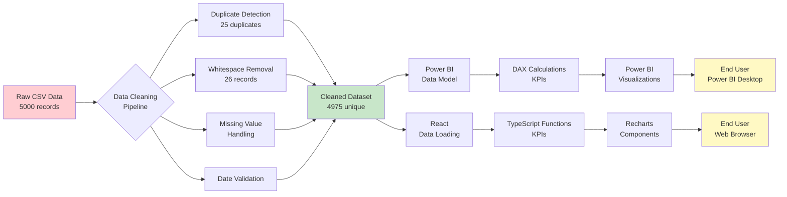
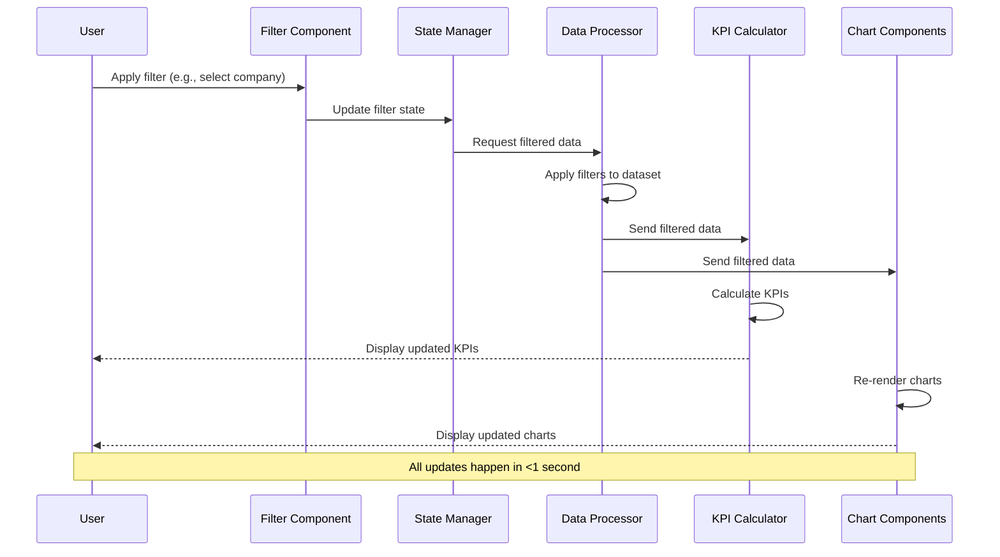
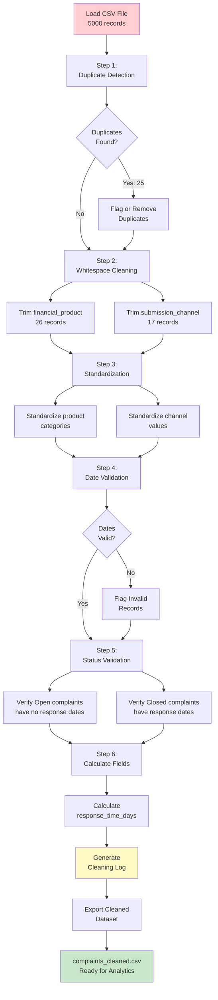
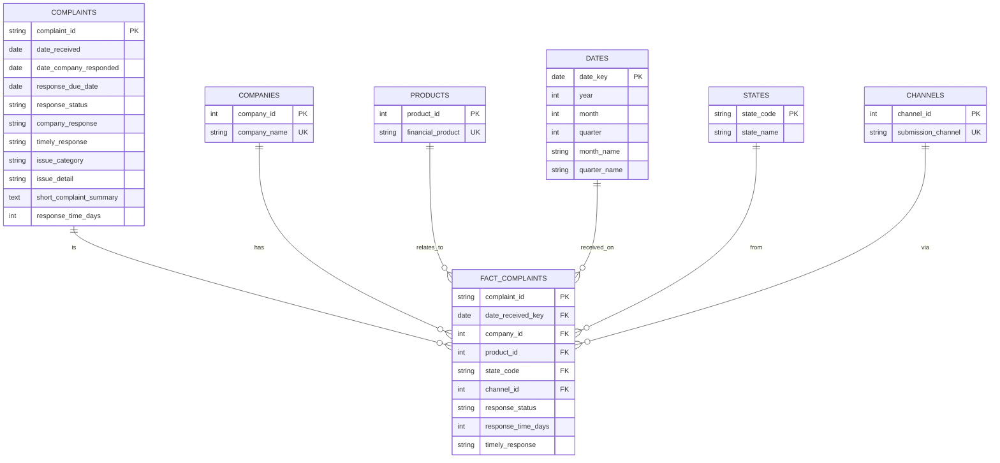

# Technical Requirements Document (TRD)
## Financial Customer Complaint Analytics Platform

---

## Document Information

| Property | Value |
|----------|-------|
| **Document Title** | Technical Requirements Document - Financial Customer Complaint Analytics Platform |
| **Version** | 1.1 |
| **Date** | November 22, 2026 |
| **Author** | Technical Architecture Team |
| **Status** | Draft |
| **Classification** | Internal |
| **Related Documents** | PRD_Financial_Complaint_Analytics.md |

---

## Version History

| Version | Date | Author | Changes |
|---------|------|--------|---------|
| 1.0 | 2026-11-22 | Technical Team | Initial TRD based on actual dataset analysis |
| 1.1 | 2026-11-22 | Technical Team | Corrected KPI baselines after data cleaning audit, clarified duplicate removal strategy, updated distributions |

---

## Table of Contents

1. [Technical Overview](#1-technical-overview)
2. [System Architecture](#2-system-architecture)
3. [Data Dictionary](#3-data-dictionary)
4. [Data Cleaning and Transformation](#4-data-cleaning-and-transformation)
5. [Database Design](#5-database-design)
6. [SQL Analysis Queries](#6-sql-analysis-queries)
7. [Power BI Implementation](#7-power-bi-implementation)
8. [React Application Architecture](#8-react-application-architecture)
9. [Security and Privacy](#9-security-and-privacy)
10. [Performance Optimization](#10-performance-optimization)
11. [Testing Strategy](#11-testing-strategy)
12. [Deployment Architecture](#12-deployment-architecture)
13. [Maintenance and Support](#13-maintenance-and-support)

---

## 1. Technical Overview

### 1.1 Solution Summary

The Financial Customer Complaint Analytics Platform is a dual-implementation business intelligence solution consisting of:

1. **Power BI Desktop Dashboard** - Enterprise analytics with DAX-powered calculations
2. **React Web Dashboard** - Modern web application with client-side data processing

Both implementations share identical business logic, KPI definitions, and data processing rules, ensuring consistency across platforms.

### 1.2 Technology Stack

#### Power BI Stack

| Layer | Technology | Version | Purpose |
|-------|-----------|---------|---------|
| **BI Tool** | Power BI Desktop | Latest (Nov 2026) | Data visualization and reporting |
| **Data Source** | CSV File | N/A | Cleaned complaint data |
| **Calculation Engine** | DAX | Power BI native | KPI and metric calculations |
| **Data Model** | Star Schema | N/A | Optimized for analytics |

#### React Web Stack

| Layer | Technology | Version | Purpose |
|-------|-----------|---------|---------|
| **Framework** | React | 18.3+ | UI component library |
| **Language** | TypeScript | 5.0+ | Type-safe development |
| **Build Tool** | Vite | 5.0+ | Fast development and building |
| **Styling** | Tailwind CSS | 3.4+ | Utility-first CSS framework |
| **Charts** | Recharts | 2.10+ | React charting library |
| **Deployment** | Vercel | Latest | Serverless hosting platform |
| **Version Control** | GitHub | N/A | Code repository and CI/CD |

#### Data Processing Stack

| Layer | Technology | Version | Purpose |
|-------|-----------|---------|---------|
| **Data Cleaning** | Python | 3.9+ | Data validation and transformation |
| **Data Analysis** | Pandas | 2.0+ | Data manipulation |
| **Data Format** | CSV | UTF-8 | Data storage format |

### 1.3 Architecture Decision Records

#### ADR-001: Why Power BI Desktop instead of Power BI Service?

**Decision:** Use Power BI Desktop for initial implementation

**Rationale:**
- No Power BI Pro licensing costs
- Simpler deployment (file sharing)
- Suitable for training dataset scope (~5,000 records)
- Can migrate to Service later if needed

**Consequences:**
- No automatic data refresh (manual data reload required)
- Limited collaboration features
- Manual file distribution

---

#### ADR-002: Why Client-Side Data Processing for React?

**Decision:** Process CSV data entirely in browser (no backend)

**Rationale:**
- Simplified architecture (no server/database required)
- Lower hosting costs (static site)
- Acceptable performance for 5,000 records
- Faster development cycle

**Consequences:**
- Performance limitations with larger datasets (>10,000 records)
- No server-side data validation
- Data exposed in network requests (acceptable for non-sensitive training data)

---

#### ADR-003: Why Recharts for Visualization?

**Decision:** Use Recharts instead of alternatives (Chart.js, D3.js)

**Rationale:**
- Native React components (declarative API)
- Good TypeScript support
- Sufficient feature set for requirements
- Active maintenance and community

**Consequences:**
- Less customization than D3.js
- Limited 3D chart options (not required)

---


## 2. System Architecture

### 2.1 High-Level Architecture



### 2.2 Data Flow Architecture



### 2.3 Component Interaction Diagram



---


## 3. Data Dictionary

### 3.1 Source Data Schema

**File:** `lecture-file.csv`  
**Encoding:** UTF-8  
**Delimiter:** Comma (,)  
**Header Row:** Yes (Row 1)  
**Total Records:** 5,000  
**Unique Complaints:** 4,975  
**Date Range:** 2025-10-01 to 2026-10-15

### 3.2 Column Definitions

#### Column 1: complaint_id

| Property | Value |
|----------|-------|
| **Data Type** | String |
| **Format** | CMP-XXXXXX (6 digits) |
| **Required** | Yes |
| **Unique** | Should be (25 duplicates found) |
| **Example** | CMP-102103 |
| **Null Count** | 0 |
| **Validation** | Matches pattern `^CMP-\d{6}$` |
| **Business Rule** | Primary identifier for complaints |

---

#### Column 2: date_received

| Property | Value |
|----------|-------|
| **Data Type** | Date |
| **Format** | YYYY-MM-DD |
| **Required** | Yes |
| **Range** | 2025-10-01 to 2026-10-15 |
| **Example** | 2026-09-15 |
| **Null Count** | 0 |
| **Validation** | Valid date, within reasonable range |
| **Business Rule** | Date customer submitted complaint |

---

#### Column 3: financial_product

| Property | Value |
|----------|-------|
| **Data Type** | String |
| **Required** | Yes |
| **Null Count** | 0 |
| **Unique Values** | 11 (6 after cleaning) |
| **Data Quality Issues** | 26 records with leading/trailing whitespace |
| **Standardized Categories** | Credit card, Checking or savings account, Credit reporting, Personal loan, Mortgage, Buy now pay later |
| **Example** | Credit card |
| **Validation** | Must match one of 6 standard categories after cleaning |

**Distribution:**
- Credit card: 1,191 (23.94%)
- Checking or savings account: 1,054 (21.19%)
- Credit reporting: 906 (18.21%)
- Personal loan: 826 (16.60%)
- Mortgage: 648 (13.03%)
- Buy now, pay later: 350 (7.04%)

---

#### Column 4: issue_category

| Property | Value |
|----------|-------|
| **Data Type** | String |
| **Required** | Yes |
| **Null Count** | 0 |
| **Unique Values** | 22 |
| **Example** | Unexpected fees |
| **Validation** | Free text, no standardization required |

**Top 10 Categories:**
1. Unexpected fees: 545
2. Account access: 337
3. Fraudulent charges: 307
4. Card declined: 299
5. Billing dispute: 296
6. Transaction dispute: 285
7. Account closure: 259
8. Report access: 242
9. Investigation delay: 226
10. Incorrect information: 228

---

#### Column 5: issue_detail

| Property | Value |
|----------|-------|
| **Data Type** | String |
| **Required** | Yes |
| **Null Count** | 0 |
| **Unique Values** | 4 |
| **Values** | Processing problem, Documentation issue, Account review requested, General inquiry |
| **Example** | Account review requested |

---

#### Column 6: company_name

| Property | Value |
|----------|-------|
| **Data Type** | String |
| **Required** | Yes |
| **Null Count** | 0 |
| **Unique Values** | 8 |
| **Example** | Harbor Credit |
| **Validation** | Must match one of 8 known companies |

**Distribution:**
- Harbor Credit: 669 (13.48%)
- Silverline Lending: 637 (12.78%)
- Atlas Consumer Finance: 630 (12.66%)
- Northstar Financial: 628 (12.66%)
- OakBridge Services: 629 (12.60%)
- BluePeak Bank: 618 (12.42%)
- Cedar Finance: 602 (12.10%)
- Summit Payments: 562 (11.30%)

---

#### Column 7: state

| Property | Value |
|----------|-------|
| **Data Type** | String |
| **Format** | 2-letter US state code |
| **Required** | No |
| **Null Count** | 49 (0.98%) |
| **Unique Values** | 17 |
| **Example** | IL |
| **Validation** | Valid US state abbreviation or NULL |

**Top 10 States:**
1. IL: 324 (6.48%)
2. OH: 319 (6.38%)
3. NY: 314 (6.28%)
4. VA: 312 (6.24%)
5. NJ: 310 (6.23%)

---

#### Column 8: submission_channel

| Property | Value |
|----------|-------|
| **Data Type** | String |
| **Required** | Yes |
| **Null Count** | 0 |
| **Unique Values** | 8 (4 after cleaning) |
| **Data Quality Issues** | 17 records with leading/trailing whitespace |
| **Standardized Values** | Web, Phone, Mail, Referral |
| **Example** | Mail |

**Distribution:**
- Referral: 1,265 (25.30%)
- Phone: 1,256 (25.12%)
- Web: 1,254 (25.08%)
- Mail: 1,225 (24.50%)

---

#### Column 9: response_due_date

| Property | Value |
|----------|-------|
| **Data Type** | Date |
| **Format** | YYYY-MM-DD |
| **Required** | Yes |
| **Null Count** | 0 |
| **Example** | 2026-09-30 |
| **Validation** | Valid date, must be ≥ date_received |
| **Business Rule** | Typically 15 days after date_received |

---

#### Column 10: date_company_responded

| Property | Value |
|----------|-------|
| **Data Type** | Date |
| **Format** | YYYY-MM-DD |
| **Required** | For closed complaints only |
| **Null Count** | 310 (6.23%) - all Open complaints |
| **Example** | 2026-09-23 |
| **Validation** | Valid date, must be ≥ date_received, must be NULL for Open complaints |
| **Business Rule** | Date company provided response |

---

#### Column 11: response_status

| Property | Value |
|----------|-------|
| **Data Type** | String |
| **Required** | Yes |
| **Null Count** | 0 |
| **Allowed Values** | Open, Closed |
| **Example** | Closed |
| **Validation** | Must be exactly "Open" or "Closed" |

**Distribution (After Cleaning):**
- Closed: 4,665 (93.77%)
- Open: 310 (6.23%)

---

#### Column 12: company_response

| Property | Value |
|----------|-------|
| **Data Type** | String |
| **Required** | Yes |
| **Null Count** | 0 |
| **Unique Values** | 4 |
| **Allowed Values** | Closed with explanation, Closed with non-monetary relief, Closed with monetary relief, In progress |
| **Example** | Closed with explanation |

**Distribution:**
- Closed with explanation: 3,105 (62.10%)
- Closed with non-monetary relief: 1,111 (22.22%)
- Closed with monetary relief: 473 (9.46%)
- In progress: 310 (6.23%)

---

#### Column 13: timely_response

| Property | Value |
|----------|-------|
| **Data Type** | String |
| **Required** | For closed complaints only |
| **Null Count** | 310 (6.23%) - all Open complaints |
| **Allowed Values** | Yes, No, NULL |
| **Example** | Yes |
| **Validation** | Must be NULL for Open complaints |

**Distribution (Closed complaints only):**
- Yes: 4,202 (90.08%)
- No: 463 (9.92%)

---

#### Column 14: short_complaint_summary

| Property | Value |
|----------|-------|
| **Data Type** | String (Text) |
| **Required** | Yes |
| **Null Count** | 0 |
| **Max Length** | ~150 characters |
| **Example** | Customer requests clarification of interest charges. |
| **Validation** | Free text, no validation required |
| **Business Rule** | Brief description of complaint |

---

### 3.3 Calculated Fields

#### response_time_days

| Property | Value |
|----------|-------|
| **Data Type** | Integer |
| **Calculation** | date_company_responded - date_received (in days) |
| **Required** | For closed complaints only |
| **Range** | 1 to 25 days |
| **Average** | 8.76 days |
| **Median** | 8 days |
| **Example** | 8 |
| **Business Rule** | Only calculated for Closed complaints with valid dates |

**Formula (DAX):**
```dax
response_time_days = 
DATEDIFF(
    Complaints[date_received], 
    Complaints[date_company_responded], 
    DAY
)
```

**Formula (TypeScript):**
```typescript
const responseTimeDays = 
    (new Date(dateCompanyResponded).getTime() - 
     new Date(dateReceived).getTime()) / 
    (1000 * 60 * 60 * 24);
```

---


## 4. Data Cleaning and Transformation

### 4.1 Data Quality Issues Identified

| Issue Type | Count | Percentage | Severity |
|------------|-------|------------|----------|
| **Duplicate complaint IDs** | 25 | 0.50% | High |
| **Missing state values** | 49 | 0.98% | Low |
| **Whitespace in financial_product** | 26 | 0.52% | Medium |
| **Whitespace in submission_channel** | 17 | 0.34% | Medium |
| **Open complaints without response dates** | 310 | 6.23% | Expected |
| **Closed complaints without response dates** | 0 | 0.00% | None |

### 4.2 Data Cleaning Pipeline



### 4.3 Cleaning Rules Implementation

#### Rule 1: Duplicate Handling

**Logic:**
```python
# Identify duplicates
duplicates = df[df['complaint_id'].duplicated(keep=False)]

# Strategy: Keep first occurrence, remove subsequent
df_cleaned = df.drop_duplicates(subset=['complaint_id'], keep='first')

# Log duplicates
duplicate_log = duplicates[['complaint_id', 'date_received', 'company_name']]
```

**Business Rule:** Keep the first occurrence by row order in original CSV file (pandas keep=\'first\' strategy) when duplicates exist.

---

#### Rule 2: Financial Product Standardization

**Mapping Table:**

| Original Value | Standardized Value |
|----------------|-------------------|
| " credit card " | Credit card |
| "Credit card" | Credit card |
| " checking or savings account " | Checking or savings account |
| "Checking or savings account" | Checking or savings account |
| " personal loan " | Personal loan |
| "Personal loan" | Personal loan |
| " mortgage " | Mortgage |
| "Mortgage" | Mortgage |
| " credit reporting " | Credit reporting |
| "Credit reporting" | Credit reporting |
| "Buy now, pay later" | Buy now, pay later |

**Implementation:**
```python
# Step 1: Remove whitespace
df['financial_product'] = df['financial_product'].str.strip()

# Step 2: Standardize casing (title case)
product_mapping = {
    'credit card': 'Credit card',
    'checking or savings account': 'Checking or savings account',
    'personal loan': 'Personal loan',
    'mortgage': 'Mortgage',
    'credit reporting': 'Credit reporting',
    'buy now, pay later': 'Buy now, pay later'
}

df['financial_product'] = df['financial_product'].str.lower().map(product_mapping)
```

---

#### Rule 3: Submission Channel Standardization

**Implementation:**
```python
# Step 1: Remove whitespace
df['submission_channel'] = df['submission_channel'].str.strip()

# Step 2: Standardize casing (title case)
channel_mapping = {
    'web': 'Web',
    'phone': 'Phone',
    'mail': 'Mail',
    'referral': 'Referral'
}

df['submission_channel'] = df['submission_channel'].str.lower().map(channel_mapping)
```

---

#### Rule 4: Missing Value Handling

**Strategy:** Preserve missing values as NULL/NaN - never fabricate data

**Implementation:**
```python
# State: Allow NULL values (do not fill)
# date_company_responded: NULL for Open complaints (expected)
# timely_response: NULL for Open complaints (expected)

# Validation: Warn if unexpected nulls found
if df[df['response_status'] == 'Closed']['date_company_responded'].isnull().any():
    print("WARNING: Closed complaints found with missing response dates")
```

---

#### Rule 5: Date Validation

**Validation Rules:**
```python
# Convert to datetime
df['date_received'] = pd.to_datetime(df['date_received'], errors='coerce')
df['date_company_responded'] = pd.to_datetime(df['date_company_responded'], errors='coerce')
df['response_due_date'] = pd.to_datetime(df['response_due_date'], errors='coerce')

# Validation: Response date must be >= received date
invalid_dates = df[
    (df['date_company_responded'].notna()) & 
    (df['date_company_responded'] < df['date_received'])
]

if len(invalid_dates) > 0:
    print(f"ERROR: {len(invalid_dates)} records with response date before received date")
```

---

#### Rule 6: Status Consistency Validation

**Business Logic:**
```python
# Rule 1: Open complaints must NOT have response dates
open_with_response = df[
    (df['response_status'] == 'Open') & 
    (df['date_company_responded'].notna())
]

# Rule 2: Open complaints must NOT have timely response flags
open_with_timely = df[
    (df['response_status'] == 'Open') & 
    (df['timely_response'].notna())
]

# Rule 3: Closed complaints must have response dates
closed_without_response = df[
    (df['response_status'] == 'Closed') & 
    (df['date_company_responded'].isna())
]

# Log any violations
if len(open_with_response) > 0:
    print(f"ERROR: {len(open_with_response)} open complaints have response dates")
```

---

### 4.4 Cleaning Audit Trail

**Cleaning Log Schema:**

```json
{
  "cleaning_timestamp": "2026-11-22T10:30:00Z",
  "source_file": "lecture-file.csv",
  "output_file": "complaints_cleaned.csv",
  "records_processed": 5000,
  "records_output": 4975,
  "operations": [
    {
      "operation": "duplicate_removal",
      "records_affected": 25,
      "details": "Kept first occurrence of duplicate complaint IDs"
    },
    {
      "operation": "financial_product_standardization",
      "records_affected": 26,
      "details": "Removed whitespace and standardized casing"
    },
    {
      "operation": "submission_channel_standardization",
      "records_affected": 17,
      "details": "Removed whitespace and standardized casing"
    },
    {
      "operation": "date_validation",
      "records_affected": 0,
      "details": "All dates valid"
    },
    {
      "operation": "status_consistency_check",
      "records_affected": 0,
      "details": "All status fields consistent"
    }
  ],
  "validation_summary": {
    "total_complaints": 4975,
    "open_complaints": 310,
    "closed_complaints": 4665,
    "missing_states": 49,
    "data_quality_score": 99.5
  }
}
```

---


## 5. Database Design

### 5.1 Logical Data Model

**Note:** For the current implementation, a formal database is not required (CSV-based). This section documents the logical schema for future database migration.



### 5.2 Star Schema for Power BI

**Recommended Data Model:**

```
Fact Table: Complaints
├── complaint_id (Primary Key)
├── date_received (Relationship to Date dimension)
├── company_name (Relationship to Company dimension)
├── financial_product (Relationship to Product dimension)
├── state (Relationship to State dimension)
├── submission_channel (Relationship to Channel dimension)
├── response_status
├── response_time_days
├── timely_response
└── [other measure fields]

Dimension Table: Date
├── Date (Primary Key)
├── Year
├── Quarter
├── Month
├── MonthName
└── MonthYear

Dimension Table: Companies (Optional)
├── company_name (Primary Key)
└── company_id

Dimension Table: Products (Optional)
├── financial_product (Primary Key)
└── product_id
```

**Relationships:**
- Complaints[date_received] → Date[Date] (Many-to-One)
- Complaints[company_name] → Companies[company_name] (Many-to-One)
- Complaints[financial_product] → Products[financial_product] (Many-to-One)

---

